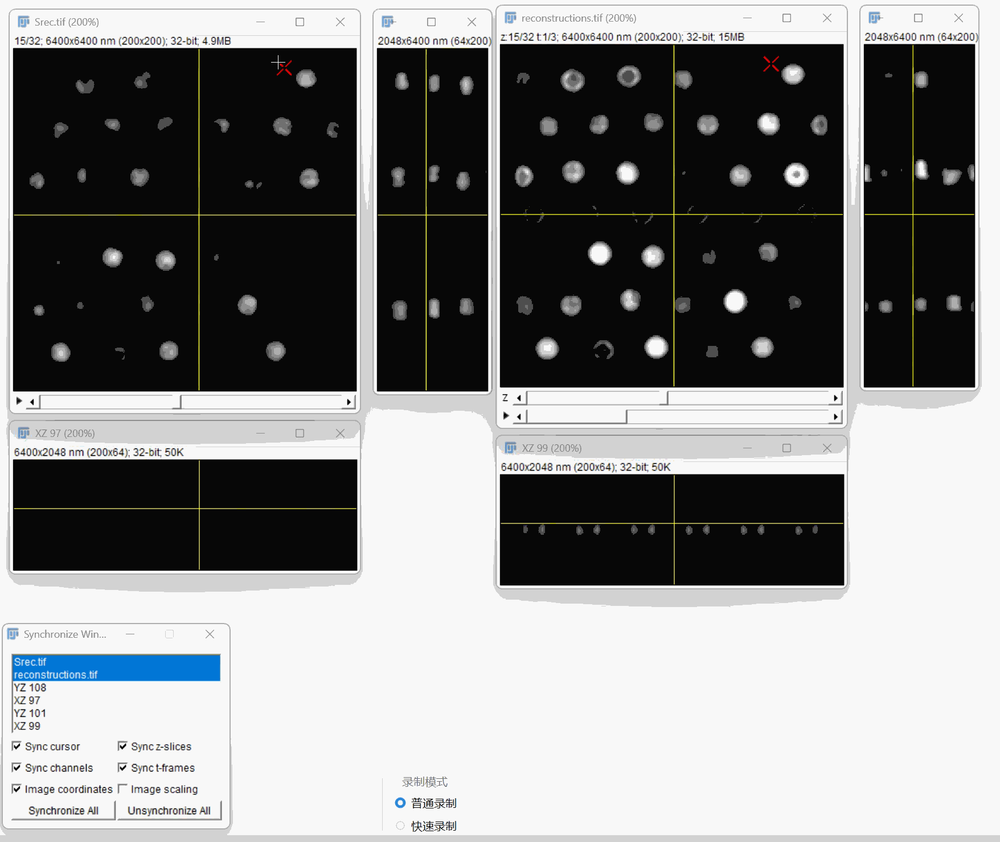

# Fiji 多图 Orthogonal Views

每个源图像独立保留一组 XY/XZ/YZ 视图。v0.2.0 增加多图截面同步、拖动性能优化和 Snapshot ZIP 拖放恢复。



## 安装

### 1. 下载完整 ImageJ（Fiji，推荐）

**[下载完整 Fiji / ImageJ（Windows 64 位）](https://github.com/gouwenct/fiji-multi-orthogonal-views/releases/download/v0.2.0/fiji-multi-orthogonal-views-full-v0.2.0.zip)**

解压到新文件夹，运行 `Fiji.app/ImageJ-win64.exe`。完整包内置 Java，并集成多图同步和 Snapshot 修复。下载后可用发行页的 `SHA256SUMS.txt` 校验文件。

### Snapshot 快照

Fiji 副本中的 `Plugins > Snapshot` 可以把多张 TIFF 的图像状态保存成一个 `.zip`，之后一次恢复整批图像。具体操作和后续批量结果的生成约定见 [SNAPSHOT.md](SNAPSHOT.md)。

### 2. 为现有 Fiji 安装补丁（可选）

需要保留现有 Fiji 环境时，可[下载补丁包](https://github.com/gouwenct/fiji-multi-orthogonal-views/releases/download/v0.2.0/fiji-multi-orthogonal-views-patch-v0.2.0.zip)。解压后保存图像并关闭 Fiji，在补丁目录运行：

```powershell
python tools/apply_patch.py "D:\Path\to\Fiji.app\jars\ij-1.54p.jar"
```

补丁支持 [PATCH.md](PATCH.md) 指定哈希的原版 `ij-1.54p.jar` 和本项目 v0.1.0。安装器同时更新 JAR 与 Snapshot 脚本，保留 `.before-v0.2.0` 备份；需要 Python 3.8 或更高版本。

## 让 Agent 安装

把下面提示词复制给有本地文件操作能力的 Agent：

```text
请帮我安装支持多图 Orthogonal Views 的 ImageJ（Fiji）：
https://github.com/gouwenct/fiji-multi-orthogonal-views/releases/tag/v0.2.0

默认下载 full 完整包，校验 Release 的 SHA256SUMS.txt 后解压到独立目录，
保留原有 Fiji 和数据。只有我明确要求给现有 Fiji 打补丁时，才下载 patch
补丁包，按 PATCH.md 校验基础 JAR 哈希并使用 tools/apply_patch.py 安装，
保留原 JAR 备份；哈希不匹配时停止。需要关闭 Fiji 时先提醒我保存图像。
安装后验证两个源图像能同时保留各自的 XY/XZ/YZ 视图，报告安装路径和结果。
```

## Git

```bash
git clone https://github.com/gouwenct/fiji-multi-orthogonal-views.git
```

这是非官方 Fiji 修改版。完整 Fiji 的原许可证和第三方声明保留在发行包中。

v0.2.0 支持把 Snapshot ZIP 直接拖到 ImageJ 主窗口、工具栏或状态栏，自动恢复快照。

## 多图 Orthogonal Views 同步

本节适用于 v0.2.0。

1. 打开 A、B、C 三个堆栈，并分别运行 `Image > Stacks > Orthogonal Views`。
2. 运行 `Analyze > Tools > Sync Windows`，按 Ctrl 在列表中选中 A、B、C 的原始图像名称。无需选派生的 XZ/YZ 窗口。
3. 保持 `Sync Cursor`、`Sync z-Slices` 和 `Image Coordinates` 开启，关闭 `Image Scaling`。

两个命令的打开顺序均可，也可以关闭后重新打开 Sync Windows。在任一已选源图像的 XY、XZ 或 YZ 视图中单击或按住左键拖动，其他已选源图像的三个正交视图会一起更新。单纯悬停不会切换截面。

没有加入 Sync Windows 列表的图像保持独立。关闭 `Sync Cursor` 可停止截面交叉点联动；关闭 `Sync z-Slices` 可保留各图像自己的 Z。`Unsynchronize All` 停止全部同步。

同步按像素坐标进行。不同图像尺寸会把交叉点裁剪到目标图像范围；精确配准仍要求图像使用相同像素几何。修复原因和鼠标回归检查见 [PATCH.md](PATCH.md)。

拖动和视图刷新限制为最多约 30 次/秒，并合并重复刷新。松开鼠标会提交最终位置，无需更改 Sync Windows 的设置。测试条件和前后测量见 [PATCH.md](PATCH.md#同步拖动性能v020)。
